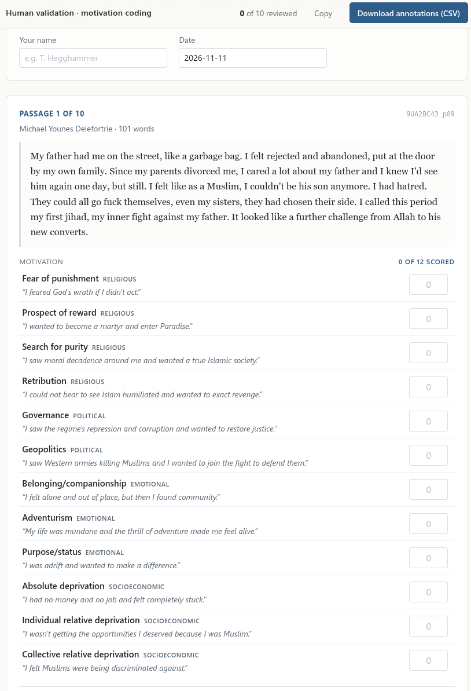

Large language models (LLMs) are becoming more and more like Swiss Army knives of natural language processing (NLP). Where we previously needed specialised machine learning models for each task -- one for named entity recognition, another for sentiment analysis, yet another for classification, and so forth -- we are moving toward a world where a single LLM can do almost all of the above. Yes, there are still issues with reproducibility (given that LLMs sample from the next-token distribution instead of decoding greedily), and yes, accuracy may still trail specialised models fine-tuned for your task. But for a lot of scenarios -- especially exploration -- it is good enough, and the convenience is hard to beat. No wonder that an increasing proportion of papers that I review have some LLM-based NLP component.

As we embrace the convenience, it is incumbent on us as academics not to blindly trust LLM output. We must uphold standards of quality control, and as a general rule we should do human validation whenever we use LLMs to generate or process data, especially in published work. Human validation is incredibly useful; aside from helping you detect biases in machine-generated output, it keeps you in touch with the primary sources. It also sensitises you to human biases; more than once I have seen human annotations trail the LLM ones in accuracy and be quite inconsistent across annotators.

But how to do it in practice? Concrete examples are surprisingly hard to come by, as published work often speaks of validation in the abstract without going into detail about how exactly it was done. Part of the problem is that every situation is different depending on the data and task at hand. Another challenge is that there are usually multiple ways of achieving the same result; in many cases you can use anything from simple text files through spreadsheets to specialised validation software.

In general, you want a solution that is simple and human-friendly, because the people doing the annotation are not necessarily that computer-savvy. At the same time, you want the annotations to be captured reliably and in a machine-readable format. Often there's a tension between the two; the more familiar the interface (e.g. a Word document), the less machine-readable the output.

Recently, my solution has been to use a coding agent to create *offline web pages* for human annotation. I just ask my coding agent to create an annotation kit centred around an HTML document that the annotator can open in his or her browser. This offline web page will have a button to export the annotations to a CSV or JSON file that machines can easily read. I then send the HTML file to the annotator, and the annotator returns the CSV or JSON file.

Here's a specific example. I am working on a project where we try to identify ideal-type motivations in first-person statements by Western jihadis. We have raw text from interviews, autobiographies, and the like, and we pass chunks of first-person speech to an LLM, asking it to assign intensity values from 0 to 100 for each of 12 ideal-type motivations. We get plausible values, but we want to know how they compare to human interpretation of the same chunks. I asked my agent running `deepseek-4.1-flash-1017` (my favourite LLM at the moment) to create an offline webpage for human validation. Here is what it produced:



It is hard to imagine a more intuitive and human-friendly annotation interface than this. The annotator just fills in the numbers, presses the blue button in the top right, and emails me the CSV. 

Here is a sample prompt you can use as a starting point: 

```
Build a human-validation kit for an LLM coding task in this repo. 
Sample <X> items from <data Y>. Categories are in <typology file Z>. 
Deliver a self-contained HTML file that opens offline, 
shows one item per screen with each category's definition beside its score box,
autosaves, and exports a CSV whose column names join onto the model scores.
```

No more manually constructed spreadsheets, no more idiosyncratic annotation software, no more cleaning up of output files. Just a simple, intuitive web form that anyone can understand and that gives clean output. In other words: no excuse for not validating our LLM output.  
